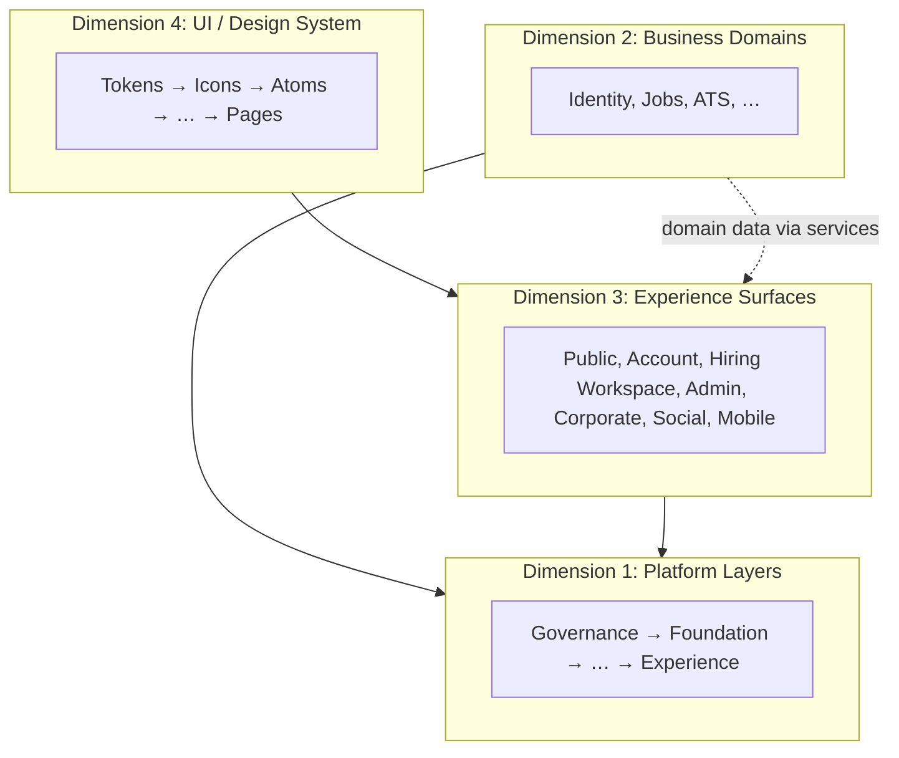
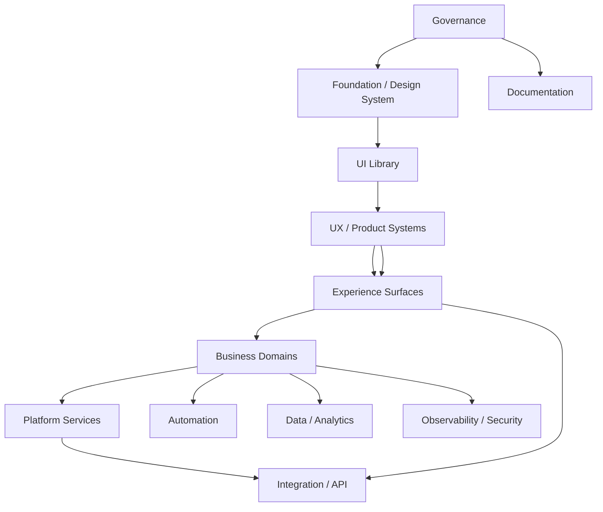
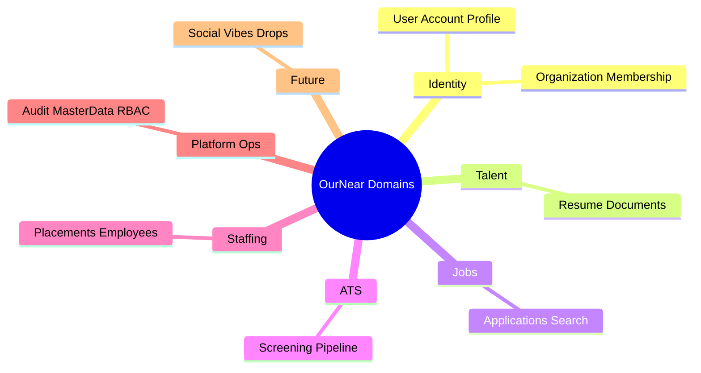
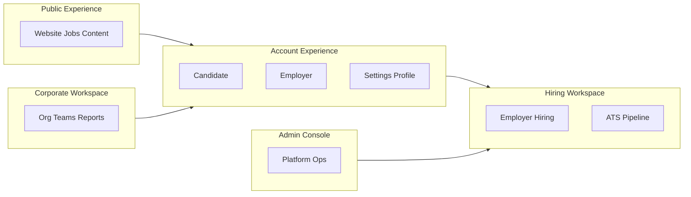
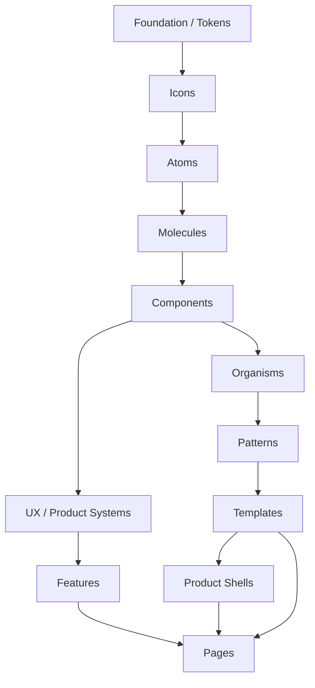
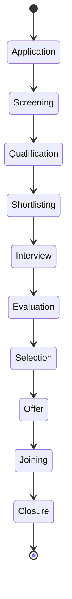
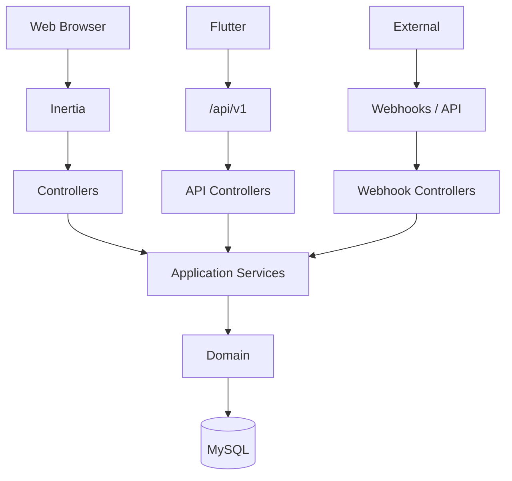
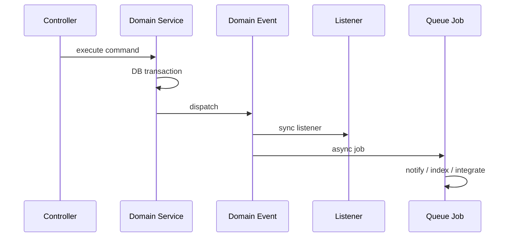

# OURNEAR UNIFIED PLATFORM ARCHITECTURE v1.1

**Document type:** Master architecture freeze (specification only)  
**Codebase anchor:** `D:\Ournear Hub\Ournear Hire` (OurNear V2 — working implementation)  
**Supersedes:** Conversational `OURNEAR_UNIFIED_PLATFORM_ARCHITECTURE_v1.0` (same content lineage; v1.1 adds four-dimension model and governance)  
**Does not supersede:** Module docs in `docs/0x-*.md` (module truth for current behavior; this doc governs placement and evolution)

---

## 1. Executive Summary

OurNear evolves from **completed V2** (Laravel 12, Inertia 3, React 19, MySQL, dual-guard auth, Hire/ATS/staffing/admin) into **OurNear Corporate / Enterprise Platform** without rebuilding the Laravel foundation.

**Strategy:**

```text
PRESERVE V2 behavior and domain services
  → STANDARDIZE foundation, tokens, UI library, UX systems
  → EXTEND organization, events, queues, API v1, platform services
  → UNIFY account, profile, and cross-surface contracts
  → SCALE as modular monolith + clear domains (not microservices by default)
```

**Web remains Inertia-first** (not API-first SPA). **Mobile (future):** Flutter → `/api/v1` → same application/domain services → MySQL. **Rejected:** Firebase/Supabase as production domain backend; microservices split; V2 rewrite.

**v1.1 refinement:** Separates **four dimensions** — Platform Layers, Business Domains, Experience Surfaces, UI/Design System — so teams do not conflate “a component,” “a domain,” and “a product shell.”

---

## 2. Architecture Status

| Area | Status |
|------|--------|
| V2 production stack | **Implemented** |
| Public / Account / Admin experiences | **Implemented** |
| RBAC (`PermissionName`, policies) | **Implemented** |
| ATS / recruitment lifecycle | **Implemented** (extend, do not replace) |
| Design tokens (`app.css`, `classNames.ts`) | **Partial** — standardize |
| Unified UI library | **Partial** — dual kits (Public/UI vs Admin/ui) |
| UX / Product Systems | **Partial** — DataTable, filters, forms ad hoc |
| Organization / multi-membership | **Architecture P0/P1** — model ahead of full Corporate UI |
| Domain events / `app/Jobs` | **Limited** — introduce incrementally |
| REST API for mobile | **Not present** — `/api/v1` planned |
| Social / Vibes / Drops | **Future** domains |
| This document | **Freeze candidate v1.1** |

---

## 3. Architecture Principles

1. **Existing functionality first** — Working V2 is intentional; extend and standardize, do not replace business logic.  
2. **Domain ownership** — One bounded context owns each capability (§6).  
3. **Separation of concerns** — UI, application orchestration, domain, infrastructure are distinct.  
4. **Dependency direction** — Inward: Experience → Application → Domain → Infrastructure; UI → UX Systems → Features → Pages.  
5. **Server source of truth** — Laravel authoritative for data, validation, authorization.  
6. **Security by default** — Policies and permissions on server; UI visibility is not authorization.  
7. **Modular monolith first** — Module boundaries inside one deployable.  
8. **Events for side effects** — Notify, audit, search, analytics, integrations via events/queues where appropriate.  
9. **Web/mobile contract parity** — Same domain concepts; presentation may differ.  
10. **Reference governance** — Reference repos inform patterns only; never production dependencies (e.g. HireMe Supabase, Firebase domain).  

**Project hard constraints** (from `AGENTS.md`, `DEVELOPMENT-RULES.md`): single `User` model; dual guards `admin` / `account`; one permission catalog; one screening/match engine (`ScreeningMatchService`); automation must not auto-hire; public `/hire` ≠ staff `/admin/hiring`.

---

## 4. Four-Dimension Architecture Model

Architecture is understood through **four orthogonal dimensions**. A single feature touchpoint may be classified in all four.

| Dimension | Question it answers | Must not be confused with |
|-----------|---------------------|---------------------------|
| **1. Platform Layers** | Where does this live technically? | A user role or a React component |
| **2. Business Domains** | What business capability owns this? | A page or shell |
| **3. Experience Surfaces** | Who sees this and in which product context? | A domain service |
| **4. UI / Design System** | How is it rendered and reused? | Domain rules |



---

## 5. Platform Layers

| # | Layer | Responsibility | Allowed dependencies | Prohibited | Current V2 | Direction |
|---|--------|----------------|----------------------|------------|------------|-----------|
| 1 | **Governance** | ADRs, standards, review checklist, asset policy | — | Product code | `AGENTS.md`, `docs/`, rules | Add architecture checklist |
| 2 | **Foundation** | Tokens, motion, a11y utilities, focus | Governance | Features | `app.css` @theme, `classNames.ts` | Full token tiers |
| 3 | **Design System** | Brand, semantic tokens, typography, density | Foundation | Domain | Tailwind theme + typography map | Document product tokens |
| 4 | **UI Library** | Atoms → organisms (presentational) | DS, Icons | Pages, Eloquent | Split UI kits | Unified library |
| 5 | **UX / Product Systems** | Form, Data, Search, File, Notify, etc. | UI Library | Unrelated domains | Partial (DataTable, useForm) | First-class systems (§10) |
| 6 | **Platform Services** | Cross-domain: org context, feature flags, audit bus | Domain interfaces, infra | React | Partial notifications, files | Extend |
| 7 | **Business Domains** | Entities, rules, policies, domain services | Other domains via services/events | React | `app/Services`, Models | + domain events |
| 8 | **Automation** | Rules, schedules, workflow execution | Domain, Platform Services | UI | Recruitment automation, scheduler | Workflow system |
| 9 | **Data / Analytics** | Persistence, metrics, reporting models | Domain | UI | MySQL, dashboard services | Event metrics |
| 10 | **Integration / API** | Inertia web, `/api/v1`, webhooks | Application services | Direct DB from mobile | Inertia only; webhooks partial | API v1 |
| 11 | **Experience / Product Surfaces** | Shells, pages, templates | UX Systems, Features | Domain internals | Pages + Layouts | + Corporate shell |
| 12 | **Observability / Security** | Logs, audit, headers, authN/Z | Infra, Domain | UI-only auth | Dual guard, RBAC, activity logs | MFA/SSO later |
| 13 | **Documentation** | Module docs, registry, architecture | Governance | — | `docs/*` | + component registry |



---

## 6. Business Domains

Classification: **Existing** | **Extension** | **Future** | **Platform/Foundation**

### Identity — Platform/Foundation (+ Existing)

| Concept | Class | Notes |
|---------|-------|-------|
| User | Existing | Canonical `App\Models\User` |
| Account (session) | Existing | Guards `account`, `admin` |
| Profile | Existing / Extension | Candidate/employer profile → unified profile contract |
| Organization | Extension | P0/P1 model; employer today ≈ org |
| Membership | Extension | User ↔ organization |
| Team / Business Unit | Future | Scoped RBAC |
| Role | Existing | `users.role` + staff roles |
| Permission | Existing | `PermissionName`, `AccessCatalog` |

### Talent / Candidate — Existing

Profile, resume, skills, experience, education, documents, verification, preferences — implemented under account + services.

### Jobs — Existing

Jobs, applications, saved jobs, search, master data — public + admin + employer.

### Employer — Existing

Employer profile, users, jobs, hiring requirements, services — extend for org membership.

### ATS / Recruitment — Existing

Screening (`ScreeningMatchService`), shortlist, interview, evaluation, selection, offer, joining, closure — **extend, never second match engine**.

### Staffing — Existing

Enquiries, placements, employees, replacements — admin + account workspaces.

### Communication — Existing / Extension

Admin Messages, mail; extend templates and cross-surface chat.

### Documents — Existing / Extension

Upload/replace, disks, authorized download; extend versioning/retention platform-wide.

### Social — Future

Posts, connections, Vibes, Drops — unified platform, separate domain modules.

### Reviews — Existing / Extension

Relationship reviews in candidate account.

### Analytics — Existing / Extension

Admin analytics, dashboard metrics — extend event-driven metrics.

### Platform Operations — Existing / Extension

Audit (activity logs), master data, config, integrations, security, observability.



---

## 7. Experience Surfaces

Surfaces are **user-facing contexts** with **separate navigation** — never one mega-nav.

| Surface | Purpose | Current anchor | Shell |
|---------|---------|----------------|-------|
| **Public** | Marketing, jobs board, services, CMS, SEO | `routes/web.php`, Public pages | PublicShell |
| **Account** | Unified login account: profile, settings | `routes/account.php` | CandidateShell / EmployerShell |
| **Hiring Workspace** | Employer hiring + internal recruiter ops | `/account/hiring/*`, employer job/applicant routes; staff `/admin/hiring` | RecruiterShell / EmployerShell |
| **Corporate Workspace** | Multi-org enterprise (teams, BU, enterprise settings) | **Future** | CorporateWorkspaceShell |
| **Admin Console** | Platform ops, ATS, CRM, finance, CMS | `routes/admin.php` | AdminShell |
| **Social Experience** | Feed, Vibes, Drops, connections | **Future** | SocialShell (within Public or app tab — TBD UX) |
| **Mobile** | Flutter client | **Future** | Native shells per surface |



**Rule:** Do not merge User dashboard, Hiring workspace, and Admin navigation (`AGENTS.md`).

---

## 8. UI / Design System Architecture

Strict hierarchy and dependency direction:

```text
Foundation
  ↓
Tokens (primitive → semantic → component → product)
  ↓
Icons (OurNearIcon registry; Tabler-backed)
  ↓
Atoms
  ↓
Molecules
  ↓
Components
  ↓
Organisms
  ↓
Patterns
  ↓
Templates
  ↓
Product Shells
  ↓
UX / Product Systems  ← cross-cutting behavior (forms, tables, search)
  ↓
Features  ← domain-specific UI (JobForm, ProfileCompletion)
  ↓
Pages  ← Inertia route targets
```

| Level | Responsibility | May import | Must not import |
|-------|----------------|------------|-----------------|
| Foundation / Tokens | Visual constants | — | Features |
| Icons | SVG/icon API | Foundation | Pages |
| Atoms | Single controls | Tokens, Icons | Domain services |
| Molecules | Label+control+error | Atoms | Pages |
| Components | Card, Dialog, DataTable shell | Molecules | Eloquent |
| Organisms | Header, SideNav | Components | Laravel |
| Patterns | ListPage, DashboardGrid | Components, UX Systems | Other features’ pages |
| Templates | Page layout composition | Patterns, Shells | Domain logic |
| Product Shells | Chrome, nav slots, context | Templates-level layout | Business rules |
| UX Systems | Form/Data/Search behavior | UI Library | Unrelated domains |
| Features | Hire-specific UI | UX Systems, UI | Other features’ pages |
| Pages | Wire props → feature | Features, Shells | Shared as library |

**Brand (frozen):** Primary `#214449`, Accent `#F15A24` — from V2 `app.css`. **Product token note:** Public primary CTA uses accent; Admin primary often uses brand — document as intentional surface tokens, not drift.



---

## 9. Product Shell Architecture

Shells are **first-class** — not “large layouts.” They define navigation ownership, auth context, responsive chrome, and permission-gated nav slots.

| Shell | Purpose | Nav ownership | Permissions | Current layout |
|-------|---------|---------------|-------------|----------------|
| **PublicShell** | Marketing + job board | `content/navigation.ts` | Public + optional auth chip | `PublicLayout` |
| **AuthShell** | Login/register/reset | Minimal | Guest | `AdminAuthLayout`, account auth pages |
| **CandidateShell** | Candidate account | Server `candidateNav` | Account candidate | `AccountLayout` + mobile nav |
| **EmployerShell** | Employer account | Server `employerNav` | Account employer | `AccountLayout` |
| **RecruiterShell** | Hiring workspace | Employer nav groups + admin ATS | Hiring permissions | Account hiring + admin hiring pages |
| **CorporateWorkspaceShell** | Multi-org enterprise | Org-scoped nav (future) | Org RBAC | **NEW** |
| **AdminShell** | Staff console | `Sidebar.tsx` + permissions | `PermissionName` | `AdminLayout` |
| **ProfileShell** | Profile-focused views | Contextual | Profile policies | `ProfileShell` component + pages |
| **SettingsShell** | Security, comm prefs | Settings subnav | Account user | Account settings routes |
| **DocumentationShell** | Internal docs / Storybook | Docs IA | Staff/dev | **NEW** |

**Relationships:**

- **Templates** fill shell **content regions** (main, drawer, aside).  
- **Pages** choose shell + template + features.  
- **Domains** supply data via controllers/services — shells never embed domain rules.

**Responsive:** Shell owns breakpoint behavior (e.g. candidate bottom nav, admin sidebar overlay, public mobile drawer) — not individual pages ad hoc.

---

## 10. UX / Product Systems

UX Systems are **behavioral and compositional frameworks** — not single components.

| System | Scope | vs Component | vs Domain | vs Page |
|--------|-------|--------------|-----------|---------|
| **Form System** | Registration, validation, Inertia errors, file fields, a11y | Uses Input, FormField molecules | Uses domain validation rules | Page submits use-case |
| **Data System** | Table, sort, filter, pagination, bulk, export | Uses DataTable component | Domain defines row auth | List pages compose |
| **Search System** | Query, filters, saved search, ranking | SearchBar UI | Domain indexes/query | Jobs/admin lists |
| **File / Document System** | Upload, preview, metadata, expiry | Upload zone UI | Document entity rules | Document pages |
| **Notification System** | Event → rule → channel → delivery | NotificationItem UI | Notification domain | Inbox pages |
| **Communication System** | Conversations, messages, templates | ChatPanel UI | Message domain | Messages page |
| **Workflow System** | Trigger, approval, history | Stepper UI | Workflow rules | Ops pages |
| **Permission System** | Roles, scopes, policy helpers | — | Access domain | Shell nav filtering |
| **Dashboard System** | Widgets, KPI layout, role visibility | StatCard | Analytics domain | Dashboard pages |
| **Analytics System** | Events, aggregation, reports | Chart widgets | Metrics domain | Analytics pages |

**Current V2 mapping:**

- Form → Inertia `useForm` + admin controls (**standardize**).  
- Data → `Admin/ui/DataTable` + `Pagination` + FilterBar (**extend**).  
- Search → admin URL filters (**standardize** pattern).  
- File → account document forms + storage disks (**extend**).  
- Notification → DatabaseNotification + shared props (**extend** router).  
- Communication → Admin Messages (**extend**).  
- Workflow → recruitment automation (**extend**).  
- Permission → existing RBAC (**keep**).  
- Dashboard → StatCard + Command Center (**extend**).  
- Analytics → dashboard/analytics services (**extend**).

---

## 11. Identity Architecture

| Term | Definition |
|------|------------|
| **User** | Authenticated principal (`users` row) |
| **Account** | Session on `account` or `admin` guard |
| **Profile** | Professional/personal data graph for a user |
| **Organization** | Tenant / company entity (employer org) |
| **Company** | Public directory representation |
| **Membership** | `(user, organization, membership_role)` |
| **Role** | Platform role and/or org role |
| **Permission** | Atomic grant from catalog |

One user may hold **multiple memberships** (future) with **context switcher** — still one User model.

**Hire identity (keep):** `person_number`, display `OurNearHireIdentity` (`ON-HIR-*`); internal `business_id` unchanged.

---

## 12. Organization Architecture

**Priority: P0/P1 platform foundation** (data model and authorization semantics before full Corporate UI).

```text
Account (auth session)
  ↓
Organization
  ↓
Membership (user + org + membership role)
  ↓
Business Unit / Team (optional)
  ↓
Role (org-scoped)
  ↓
Permission (from catalog + org scope)
  ↓
Scope
  ↓
Resource / Action
```

**Clarifications:**

- User ≠ Organization  
- User ≠ Role (role is contextual)  
- Organization ≠ Company (company may be public facet of org)  
- Role ≠ Permission  
- Membership connects users to organizations  
- **Server-side enforcement only** — UI nav is not security  

**Scopes:** `organization`, `business_unit`, `department`, `team`, `assigned_only`, `self`.

**Current:** Employer-centric 1:1 user–employer profile — **extend** to explicit Organization + Membership without breaking existing employer flows.

```mermaid
erDiagram
  USER ||--o{ MEMBERSHIP : has
  ORGANIZATION ||--o{ MEMBERSHIP : includes
  ORGANIZATION ||--o{ TEAM : contains
  MEMBERSHIP }o--|| ROLE : holds
  ROLE ||--o{ PERMISSION : grants
  PERMISSION }o-- SCOPE : applies
```

---

## 13. RBAC / Permission Architecture

- **Catalog:** `PermissionName`, `AccessCatalog`, `AuthorizationBootstrapper` — single catalog, never duplicate.  
- **Staff:** Admin guard + role slugs + permissions.  
- **Account:** Role `candidate` | `employer` + policies on resources.  
- **Future org RBAC:** Layer org scopes on membership without second catalog.  
- **UI:** Filter nav and buttons by permissions — **supplemental** to policies.

---

## 14. Unified Profile Architecture

Logical sections: Identity, About, Contact, Location, Languages, Experience, Education, Skills, Certifications, Projects, Preferences, Resume, Documents, Verification, Applications (private), Activity, Social (future), Privacy.

**Separation:**

- Profile data (user-professional)  
- Organization data (employer company)  
- Social activity (future domain)  
- Private settings (security, comm prefs)  

**Current:** Rich candidate profile + share-gated public profile — **standardize** API-shaped DTO for web + mobile.

---

## 15. Jobs Architecture

Master data (industries, categories, titles, locations, types) — admin. Job lifecycle: draft → published → applications. Public search and apply. Employer posting gated by eligibility services. Saved jobs and alerts where implemented.

**Domain owner:** Jobs. **Depends on:** Identity, Employer/Organization, Master Data.

---

## 16. Candidate Architecture

Registration, profile completion, resume library, applications, documents, notifications — account surface. **Domain owner:** Talent/Candidate. **Systems:** Form, File, Notification, Profile feature organisms.

---

## 17. Employer Architecture

Company profile, jobs, applicants (limited), hiring workspace, submissions, enquiries, documents. **Domain owner:** Employer (+ Organization extension).

---

## 18. ATS / Recruitment Architecture

**Lifecycle (preserved):**

```text
Application → Screening → Qualification → Shortlisting → Interview
  → Evaluation → Selection → Offer → Joining → Closure
```

**System:** `ScreeningMatchService` (single engine). **Surfaces:** Admin modules, Hiring Command Center (`/admin/hiring`), employer hiring views. **Automation:** Assists; **must not auto-hire**.



---

## 19. Staffing Architecture

Employer enquiries, employees, placements, replacements — existing admin + account. **Domain owner:** Staffing. Links to Employer Services and Finance.

---

## 20. Communication Architecture

Conversations, messages (admin UI today), email (Laravel mail), future push/SMS/WhatsApp recruitment channel **distinct from OTP**. Templates: operational (future) vs CMS marketing.

---

## 21. Notification Architecture

```text
Domain Event / Action
  → Notification Rule
  → Channel Router
  → In-App | Email | Push | SMS | WhatsApp
  → Delivery → Retry → Failure log → Audit
```

Preferences, quiet hours, dedup fingerprints — extend existing DatabaseNotification patterns.

---

## 22. Document Architecture

File blob on disk → Document metadata → optional Version. Type, owner, org (future), entity link, visibility, verification, expiry, retention. Authorized download controllers — **keep**; extend platform DocumentService boundary.

---

## 23. Search Architecture

Context search (admin lists, job board) today. Target: permission-aware query layer; global search P2; saved searches/views with Data System.

---

## 24. Workflow Architecture

Trigger → condition → rule → action → optional approval → outcome → history. **Current:** recruitment automation + tasks + scheduler. **Extend** without replacing screening engine.

---

## 25. Social Architecture

**Future** — Posts, Vibes, Drops, connections on same platform identity/notifications. Not a separate app codebase.

---

## 26. Reviews Architecture

Relationship reviews (existing) → extend cross-entity reviews with moderation patterns (reference: Moonbase moderation as pattern only).

---

## 27. Analytics Architecture

Dashboard metrics (existing services) → domain events → aggregates → reports. Funnel and operational KPIs P1–P2.

---

## 28. Audit Architecture

Actor, organization (future), action, resource type/id, before/after, metadata, IP, UA, timestamp, source, correlation id. **Current:** activity logs, login logs — **extend** via event listeners.

---

## 29. Integration Architecture

Webhooks (WhatsApp), Turnstile, mail; future SSO. Credentials in env; integration status in admin; retry and logging.

---

## 30. API Architecture

**Web:** Inertia → controllers → services (unchanged primary path).

**Mobile / external:**

```text
Flutter / Partner
  → /api/v1
  → API controllers
  → Form Requests + Policies
  → Application services (same as web)
  → Domain
```

| Concern | Placement |
|---------|-----------|
| Authentication | Sanctum/token (future) — separate from session guards |
| Authorization | Policies + permissions |
| Validation | Form Requests |
| DTOs / Resources | API boundary only |
| Pagination | Laravel standard |
| Errors | JSON envelope, codes |
| Versioning | `/api/v1` |
| Rate limiting | Route middleware |

**Not API-first for web** — do not convert admin to SPA.



---

## 31. Event Architecture

```text
Domain Action (transaction)
  → Domain Event (named, past tense)
  → Listeners (sync: audit, critical)
  → Jobs (async: notify, email, index)
```

**Ownership:** Event defined in owning domain namespace. **Examples:** `ApplicationSubmitted`, `CandidateShortlisted`, `InterviewScheduled`, `OfferCreated`, `DocumentUploaded`, `DocumentVerified`, `JobPublished`, `MessageSent`, `NotificationCreated`, `WorkflowTriggered`.

**Current:** Minimal (`MessageSending` mail) — **introduce** incrementally with notifications/audit first.



---

## 32. Queue Architecture

**Use when:** email, push, heavy import/export, search indexing, integration calls, non-critical notifications.

**Current:** Queue config present; **no** `app/Jobs` — add incrementally. **Tests:** sync driver. **Requires:** idempotency keys (partially used), failed job monitoring, retry policy per job type.

**Transaction rule:** Commit domain state before dispatching events that trigger side effects.

---

## 33. Security Architecture

Dual session guards; CSRF; security headers; RBAC; OTP foundations; file download authorization. **Future:** MFA, SSO/SAML/OIDC, domain verification — P2+. Privacy/consent per `23-SECURITY-PRIVACY.md`.

---

## 34. Observability Architecture

Application logs, health `/up`, activity logs. **Target:** correlation id per request, workflow execution log, failed job dashboard — P2.

---

## 35. Configuration Architecture

| Layer | Examples |
|-------|----------|
| Environment | DB, mail, WhatsApp provider |
| Application | `config/*` |
| Organization | Employer/org settings (future) |
| User | Locale, communication prefs |
| Feature flags | Platform (future) |

---

## 36. Data Architecture

MySQL + Eloquent; migrations per domain; no schema rewrite for purity. Storage disks for files. Search indexes future. **Canonical User** — never duplicate identity table.

---

## 37. Mobile Architecture

Flutter → `/api/v1` → same services → MySQL. **No** direct DB. UI: Flutter widgets parallel to web atoms — shared **contracts**, not shared React code. **Priority surfaces P1:** auth, profile, jobs, apply, notifications.

---

## 38. Accessibility / Responsive Architecture

**A11y baseline:** keyboard, focus visible, dialog trap, form errors, table headers, skip link (add), reduced motion. **Responsive strategy:** Desktop persistent nav / split panes; tablet collapsible nav; mobile drawer + bottom nav (candidate) + table→card pattern for Data System.

---

## 39. Dependency Rules

**Frontend:**

```text
Foundation → UI Library → UX Systems → Features → Pages
```

**Backend:**

```text
Domain → Application Service → Controller / API → Experience
```

**Prohibited:**

- UI importing Eloquent or controllers  
- Domain importing React  
- Pages as shared imports  
- Features importing unrelated Pages  
- Frontend visibility as authorization  
- Mobile → MySQL  
- Reference repos as runtime dependencies  

---

## 40. Domain vs Feature vs Page (examples)

| Domain | Feature | System | Template | Shell | Page |
|--------|---------|--------|----------|-------|------|
| Recruitment | Candidate screening UI | ScreeningMatchService | ListTemplate | RecruiterShell | Admin Screening Index |
| Jobs | Employer job posting | PostingEligibilityService | EditTemplate | EmployerShell | Employer Jobs Form |
| Jobs | Public job search | Job query service | SearchTemplate | PublicShell | Jobs Index |
| Talent | Profile completion | ProfileCompletionService | ProfileTemplate | CandidateShell | Account Profile |
| Staffing | Enquiry list | EmployerStaffingServices | ListTemplate | EmployerShell | Account Enquiries |
| Communication | Admin inbox | Message service | DetailTemplate | AdminShell | Admin Messages |
| Social (future) | Feed | Feed service | FeedTemplate | SocialShell | Feed Page |

---

## 41. Current → Target Mapping

| Current | Target | Action |
|---------|--------|--------|
| Laravel monolith | Modular monolith | **Keep** |
| Inertia web | Experience layer (web) | **Keep** |
| `PermissionName` | Permission catalog | **Keep** |
| Policies | RBAC layer | **Keep** |
| `app.css` @theme | Foundation tokens | **Standardize** |
| `classNames.ts` | UI foundation | **Standardize** |
| Manual SVG icons | OurNearIcon registry (Tabler) | **Standardize** |
| Dual UI kits | Unified UI library | **Standardize** |
| `DataTable` | Data System v1 | **Extend** |
| FilterBar / SearchBar | Search System pattern | **Standardize** |
| Layouts | Product Shells | **Keep** → formalize |
| `app/Services` | Domain/application services | **Keep** |
| DatabaseNotification | Notification System | **Extend** |
| Admin Messages | Communication System | **Extend** |
| Activity logs | Audit System | **Extend** |
| Dashboard metrics | Analytics System | **Extend** |
| No `routes/api.php` | `/api/v1` | **Introduce later** (P1) |
| No `app/Jobs` | Queue/job layer | **Introduce later** (P1) |
| Limited domain events | Domain event layer | **Introduce later** (P1) |
| Employer profile | Organization + Membership | **Extend** (P0/P1 model) |

**Do not replace:** Screening engine, User model, dual guards, V2 routes/workflows.

---

## 42. Architecture Decision Records

| ID | Decision | Status |
|----|----------|--------|
| ADR-001 | Modular monolith | CURRENT |
| ADR-002 | Laravel + Inertia for web (not SPA API-first) | CURRENT |
| ADR-003 | `/api/v1` for mobile/external | FUTURE P1 |
| ADR-004 | MySQL production database | CURRENT |
| ADR-005 | No Firebase/Supabase domain backend | REJECTED |
| ADR-006 | Product Shells as first-class architecture | CURRENT v1.1 |
| ADR-007 | UX/Product Systems separate from components | CURRENT v1.1 |
| ADR-008 | Organization + Membership foundation P0/P1 | CURRENT v1.1 |
| ADR-009 | Domain events + queue side effects | FUTURE P1 |
| ADR-010 | Tabler → OurNear icon registry | APPROVED direction |
| ADR-011 | Reference library — patterns only, no deps | CURRENT |
| ADR-012 | Unified Profile contract (web + API) | EXTENSION |
| ADR-013 | Separate nav per experience surface | CURRENT |
| ADR-014 | Server-side authorization only | CURRENT |
| ADR-015 | No microservices until proven need | CURRENT |
| ADR-016 | Single User, dual guards | CURRENT |
| ADR-017 | Single screening/match engine | CURRENT |
| ADR-018 | Automation must not auto-hire | CURRENT |

---

## 43. Architecture Governance

**Every new feature must document:**

1. Domain  
2. Platform / UX System used  
3. Experience surface  
4. Product Shell  
5. Template  
6. Feature module name  
7. Page(s)  
8. Permissions (catalog keys)  
9. Domain events emitted  
10. Notifications triggered  
11. Audit requirements  
12. API exposure (if any)  
13. Mobile impact  
14. Analytics events  

Reviews block merge if dependency rules violated (UI→Domain leak, second permission catalog, second match engine).

---

## 44. Implementation Phases

| Phase | Focus | Priority |
|-------|-------|----------|
| 0 | Governance + library spec (no mass moves) | P0 |
| 1 | Tokens, icons, unified atoms, shells documented | P0 |
| 2 | Organization/membership model + scopes (backend-first) | P0/P1 |
| 3 | UX systems: Form, Data, States | P1 |
| 4 | Events, jobs, notification router | P1 |
| 5 | API v1 core (mobile auth, profile, jobs) | P1 |
| 6 | Unified profile DTO + extend Hire surfaces | P1 |
| 7 | Workflow/approval UI | P2 |
| 8 | Corporate Workspace shell + nav | P2 |
| 9 | Social/Vibes/Drops domains | P3 |
| 10 | Enterprise SSO/MFA, advanced analytics | P3 |

---

## 45. Non-Goals

- Rebuild Laravel or V2  
- Microservices now  
- API-first web admin SPA  
- Firebase/Supabase domain backend  
- Merge reference codebases  
- Big-bang folder renames  
- Full Corporate UI before org foundation  
- Auto-hire automation  
- Re-audit references or full codebase in architecture tasks  

---

## Architecture Freeze Gate

**Verdict: READY**

v1.1 separates the four architecture dimensions, formalizes Product Shells and UX/Product Systems, elevates Organization/Membership to P0/P1 foundation, and preserves V2 with explicit current→target actions. Unresolved **implementation** work (API routes, jobs, org migrations) is scheduled in phases — not architectural blockers.

**Conditions (informational, not blocking library spec):**

- Corporate Workspace **URL and nav IA** may be refined during Library Spec v1.0 without changing domain model.  
- **Product token** documentation (accent vs brand primary per surface) should be fixed in Design System spec alongside library v1.0.

---

## NEXT STEP

**OurNear Corporate Library Specification v1.0** — define package boundaries, component catalog, token tables, OurNearIcon registry contract, UX system APIs, and shell composition rules aligned with §8–§10 of this document.

---

*End of OURNEAR UNIFIED PLATFORM ARCHITECTURE v1.1*
